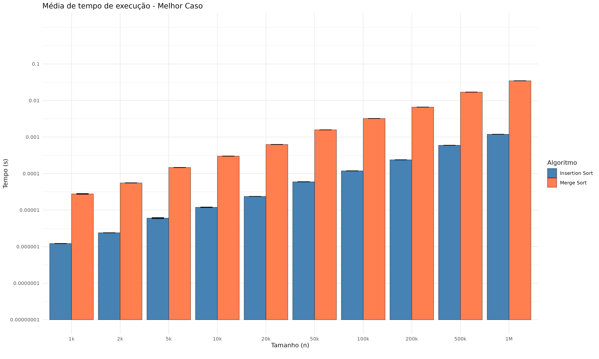
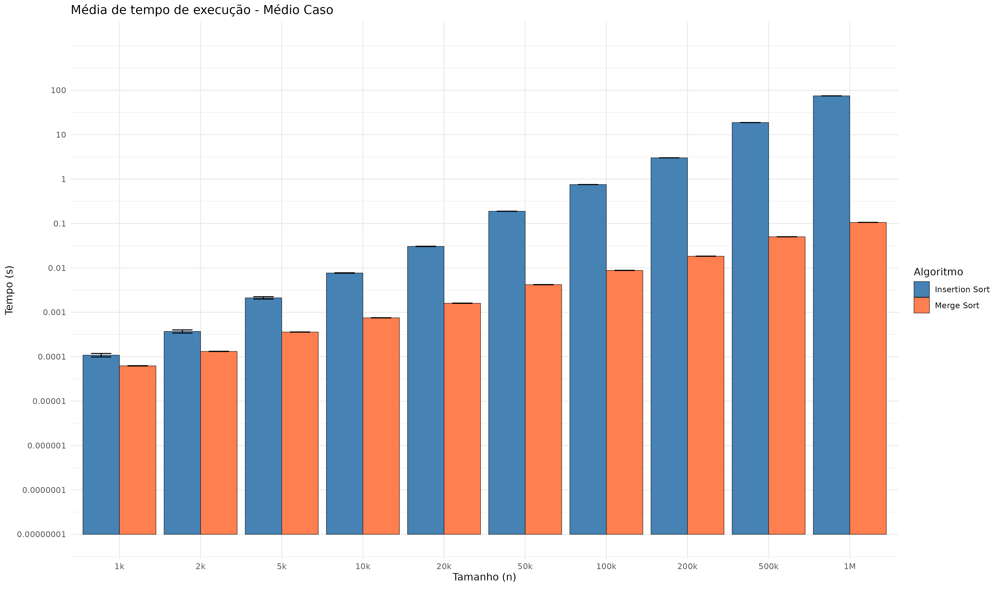
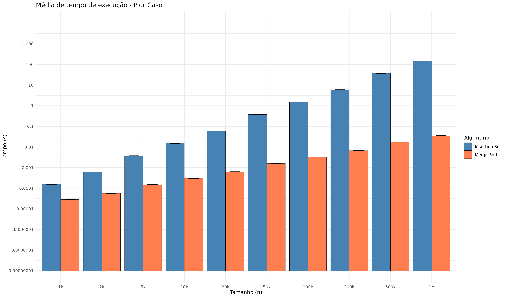
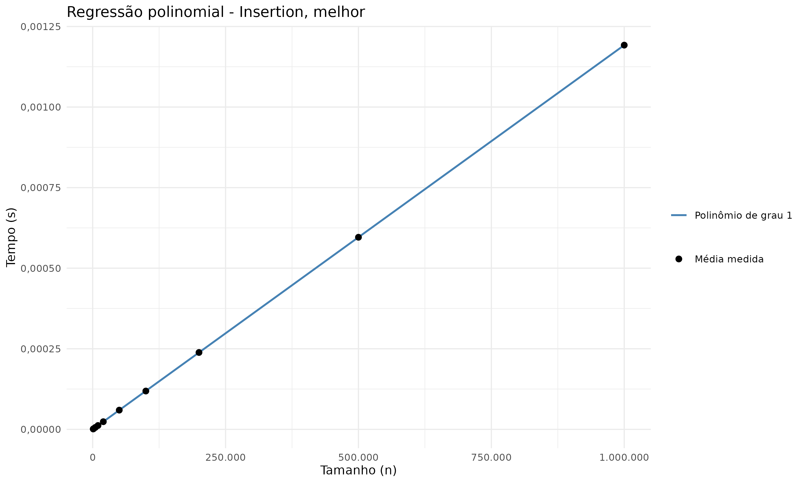
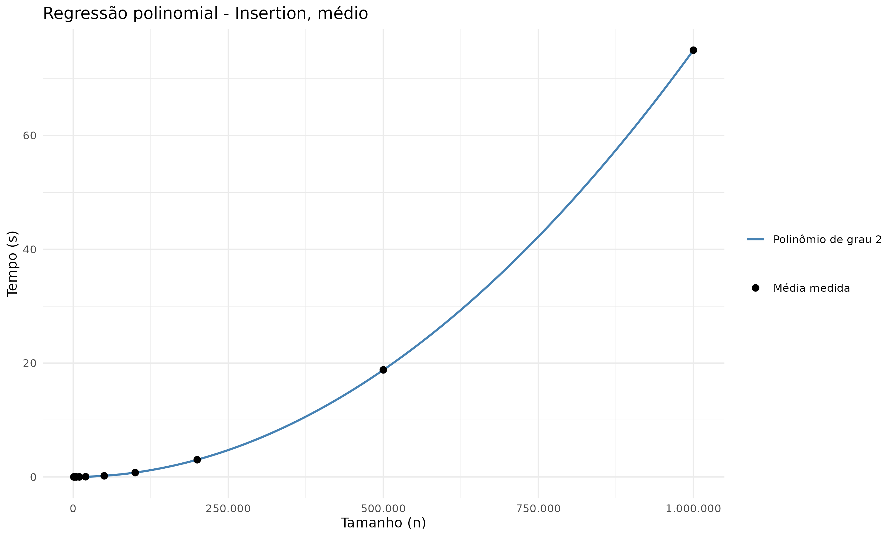
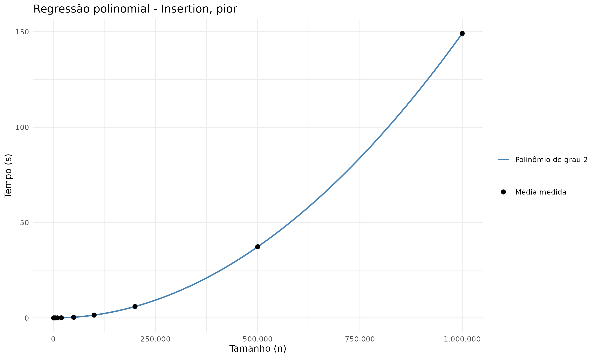
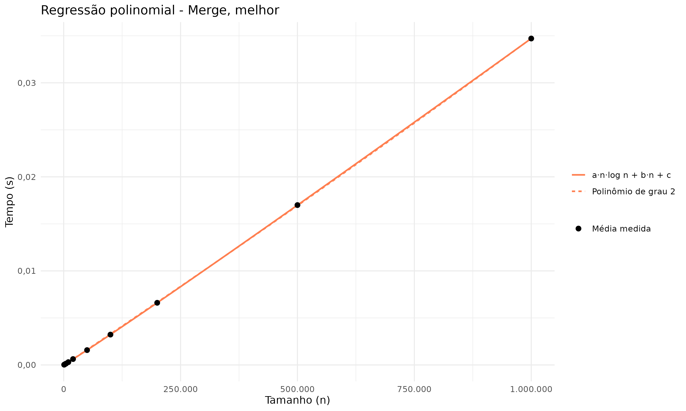
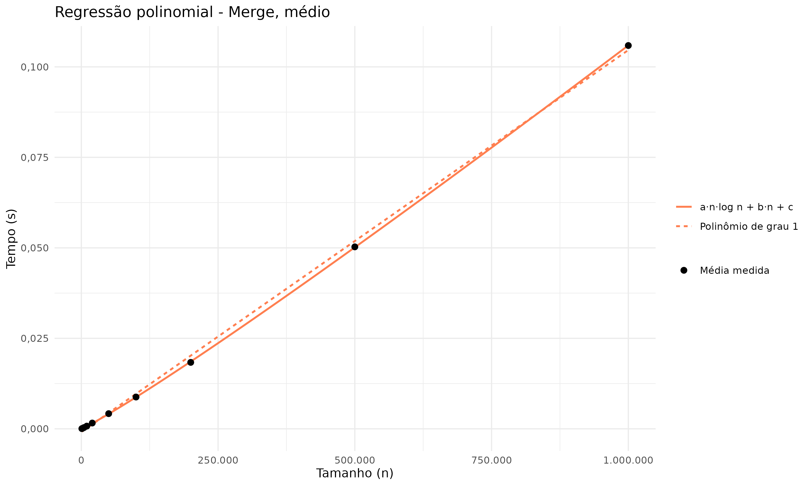
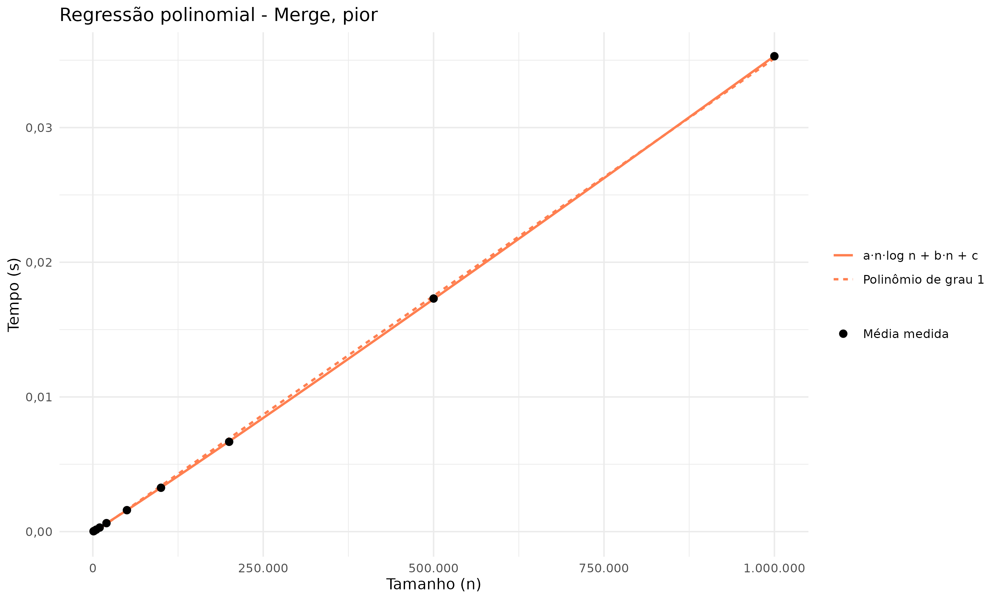

# Análise experimental dos algoritmos Insertion Sort e Merge Sort

## 1. Introdução

Este trabalho avalia empiricamente os algoritmos **Insertion Sort** e **Merge Sort**, implementados em C, para verificar se os tempos reais de execução (sujeitos a hardware, compilador e sistema operacional) confirmam o comportamento assintótico teórico:
- **Insertion Sort**: linear, $O(n)$, no melhor caso; quadrático, $O(n^2)$, nos casos médio e pior.
- **Merge Sort**: linearítmico, $O(n \log n)$, nos três cenários.

Os tempos coletados em diferentes tamanhos de entrada foram analisados em R por meio de estatística descritiva e regressão polinomial.

---

## 2. Metodologia

### 2.1 Especificações da máquina

- **Processador**: AMD Ryzen 7 5700X
- **Memória RAM**: 16 GB (2 × 8 GB, 2666 MHz)
- **Sistema operacional**: Linux CachyOS (baseado no Arch Linux)

### 2.2 Compilador e flags

Compilação com **GCC 16.2.1** (extensão *C/C++ Compile Run* do VS Code), utilizando as flags padrão `-Wall -Wextra` (avisos) e `-g3` (depuração), além da flag `-O2` (otimização de desempenho) adicionada manualmente.

### 2.3 Medição de tempo

Utilizou-se `clock_gettime()` (`<time.h>`) com o relógio `CLOCK_MONOTONIC` (resolução de nanossegundos, imune a ajustes no relógio do sistema). A medição envolve apenas a chamada de cada algoritmo, excluindo a geração dos vetores e a gravação em disco. No Merge Sort, a alocação dos vetores auxiliares ocorre dentro de `merge` e integra o tempo medido.

### 2.4 Geração de vetores

Foram testados 10 tamanhos, $n \in \{1.000; 2.000; 5.000; 10.000; 20.000; 50.000; 100.000; 200.000; 500.000; 1.000.000\}$:
- **Melhor caso**: ordem crescente de $1$ a $n$ (`A[k] = k + 1`).
- **Caso médio**: pseudoaleatórios entre $1$ e $1.000.000$ (`rand() % 1000000 + 1`), com semente única `srand(time(NULL))` e novo vetor a cada repetição.
- **Pior caso**: ordem decrescente de $n$ a $1$ (`A[k] = n - k`).

A cada iteração, o vetor gerado é copiado com `memcpy` para que o Insertion Sort (original) e o Merge Sort (cópia) ordenem exatamente a mesma entrada.

### 2.5 Quantidade de repetições realizadas

Executaram-se **50 repetições** por combinação de algoritmo, cenário e tamanho (todas concluídas; maior tempo médio: ~149 s no Insertion Sort, pior caso, $n = 1.000.000$). Os resultados foram salvos em 6 arquivos CSV (`run;size;evaluated_time`).

### 2.6 Função de benchmark

A função `benchmark` recebe os nomes dos dois CSVs de saída e o código do cenário. Para cada repetição e tamanho, gera e copia o vetor, cronometra o Insertion Sort e o Merge Sort e grava os resultados. É chamada três vezes no `main` (uma por cenário).

### 2.7 Cálculos estatísticos

Realizados em **R 4.6.1** (gráficos com `ggplot2`). Para cada configuração ($n = 50$), calcularam-se média (`mean()`), desvio-padrão amostral (`sd()`, divisão por $n - 1$), mínimo (`min()`), máximo (`max()`) e intervalo de confiança de 95% ($\bar{x} \pm t \cdot s/\sqrt{n}$, usando `qt(0.975, df = n - 1)` da distribuição $t$ de Student, dado o desvio-padrão populacional desconhecido; Bruce, Bruce e Gedeck, 2025).

### 2.8 Regressão polinomial

Ajustaram-se polinômios de grau $k$, $T(n) = \beta_0 + \beta_1 n + \dots + \beta_k n^k$, às médias via `lm(media ~ poly(tamanho, grau, raw = TRUE))`. O grau (entre 1 e 4) foi escolhido por **validação por extrapolação**: ajuste em $n < 100.000$ e previsão para $100.000 \le n \le 1.000.000$, vencendo o menor erro relativo médio absoluto, `E = (1/m) · Σ |(Tᵢ − T̂ᵢ) / Tᵢ|`. Para o Merge Sort, comparou-se também com o modelo teórico $T(n) = a \cdot n \log n + b \cdot n + c$ (`lm(media ~ I(tamanho * log(tamanho)) + tamanho)`). Complementarmente, avaliou-se a razão $T(2n)/T(n)$ ao dobrar $n$ (esperada: $2$ para $O(n)$, $\approx 2{,}1$ para $O(n \log n)$ e $4$ para $O(n^2)$).

---

## 3. Resultados

Tempos em segundos, obtidos de 50 repetições por configuração (apresentados sem interpretação).

### 3.1 Insertion Sort

De $n = 1.000$ a $n = 1.000.000$, o tempo médio varia de `1,21900E-06` s a `1,19207E-03` s no melhor caso; de `1,08582E-04` s a `74,9972` s no caso médio; e de `1,55056E-04` s a `149,147` s no pior caso.

**Tabela 1 – Estatísticas do Insertion Sort no melhor caso (tempos em segundos)**

| Tamanho | Média | Desvio-padrão | IC inferior | IC superior | Valor mínimo | Valor máximo |
| --- | ---: | ---: | ---: | ---: | ---: | ---: |
| 1000 | 1,21900E-06 | 1,84336E-08 | 1,21376E-06 | 1,22424E-06 | 1,21000E-06 | 1,31000E-06 |
| 2000 | 2,40020E-06 | 1,15157E-08 | 2,39693E-06 | 2,40347E-06 | 2,39000E-06 | 2,43000E-06 |
| 5000 | 6,04880E-06 | 6,71248E-07 | 5,85803E-06 | 6,23957E-06 | 5,94000E-06 | 1,07000E-05 |
| 10000 | 1,19620E-05 | 5,22145E-07 | 1,18136E-05 | 1,21104E-05 | 1,18800E-05 | 1,55800E-05 |
| 20000 | 2,37452E-05 | 1,03490E-08 | 2,37423E-05 | 2,37481E-05 | 2,37300E-05 | 2,37700E-05 |
| 50000 | 5,96639E-05 | 1,12809E-06 | 5,93433E-05 | 5,99845E-05 | 5,92900E-05 | 6,51100E-05 |
| 100000 | 1,18903E-04 | 1,12699E-06 | 1,18583E-04 | 1,19223E-04 | 1,18580E-04 | 1,23890E-04 |
| 200000 | 2,38546E-04 | 2,17867E-06 | 2,37926E-04 | 2,39165E-04 | 2,37130E-04 | 2,43360E-04 |
| 500000 | 5,96001E-04 | 2,68609E-06 | 5,95238E-04 | 5,96764E-04 | 5,92840E-04 | 6,06411E-04 |
| 1000000 | 1,19207E-03 | 3,63303E-06 | 1,19104E-03 | 1,19311E-03 | 1,18913E-03 | 1,21282E-03 |

**Tabela 2 – Estatísticas do Insertion Sort no caso médio (tempos em segundos)**

| Tamanho | Média | Desvio-padrão | IC inferior | IC superior | Valor mínimo | Valor máximo |
| --- | ---: | ---: | ---: | ---: | ---: | ---: |
| 1000 | 1,08582E-04 | 3,44930E-05 | 9,87793E-05 | 1,18385E-04 | 7,89800E-05 | 1,63010E-04 |
| 2000 | 3,71324E-04 | 1,06660E-04 | 3,41012E-04 | 4,01637E-04 | 3,05800E-04 | 6,16859E-04 |
| 5000 | 2,11887E-03 | 4,55392E-04 | 1,98945E-03 | 2,24829E-03 | 1,85802E-03 | 3,54876E-03 |
| 10000 | 7,68488E-03 | 2,81054E-04 | 7,60501E-03 | 7,76476E-03 | 7,42950E-03 | 8,80700E-03 |
| 20000 | 3,05022E-02 | 8,18008E-04 | 3,02697E-02 | 3,07347E-02 | 2,99080E-02 | 3,46171E-02 |
| 50000 | 1,88887E-01 | 1,00355E-03 | 1,88602E-01 | 1,89173E-01 | 1,86590E-01 | 1,91382E-01 |
| 100000 | 7,55471E-01 | 2,67661E-03 | 7,54710E-01 | 7,56232E-01 | 7,48667E-01 | 7,62353E-01 |
| 200000 | 3,01634E+00 | 1,16934E-02 | 3,01302E+00 | 3,01967E+00 | 2,99158E+00 | 3,03694E+00 |
| 500000 | 1,88077E+01 | 6,22903E-02 | 1,87900E+01 | 1,88254E+01 | 1,86668E+01 | 1,89221E+01 |
| 1000000 | 7,49972E+01 | 1,23920E-01 | 7,49620E+01 | 7,50324E+01 | 7,47417E+01 | 7,53327E+01 |

**Tabela 3 – Estatísticas do Insertion Sort no pior caso (tempos em segundos)**

| Tamanho | Média | Desvio-padrão | IC inferior | IC superior | Valor mínimo | Valor máximo |
| --- | ---: | ---: | ---: | ---: | ---: | ---: |
| 1000 | 1,55056E-04 | 1,73401E-06 | 1,54563E-04 | 1,55549E-04 | 1,54269E-04 | 1,59849E-04 |
| 2000 | 6,08290E-04 | 3,00339E-06 | 6,07436E-04 | 6,09143E-04 | 6,04419E-04 | 6,19519E-04 |
| 5000 | 3,74920E-03 | 5,57385E-06 | 3,74761E-03 | 3,75078E-03 | 3,74380E-03 | 3,77512E-03 |
| 10000 | 1,50527E-02 | 1,31314E-04 | 1,50154E-02 | 1,50901E-02 | 1,49727E-02 | 1,55569E-02 |
| 20000 | 6,03806E-02 | 1,71235E-04 | 6,03319E-02 | 6,04292E-02 | 5,97586E-02 | 6,05227E-02 |
| 50000 | 3,75888E-01 | 2,27115E-03 | 3,75243E-01 | 3,76534E-01 | 3,72419E-01 | 3,77916E-01 |
| 100000 | 1,50192E+00 | 9,38575E-03 | 1,49925E+00 | 1,50458E+00 | 1,48950E+00 | 1,51645E+00 |
| 200000 | 5,99207E+00 | 2,76956E-02 | 5,98420E+00 | 5,99994E+00 | 5,96449E+00 | 6,06076E+00 |
| 500000 | 3,73170E+01 | 2,43483E-02 | 3,73100E+01 | 3,73239E+01 | 3,72891E+01 | 3,74030E+01 |
| 1000000 | 1,49147E+02 | 2,82050E-02 | 1,49139E+02 | 1,49155E+02 | 1,49100E+02 | 1,49231E+02 |

### 3.2 Merge Sort 

De $n = 1.000$ a $n = 1.000.000$, o tempo médio varia de `2,77947E-05` s a `3,47106E-02` s no melhor caso; de `6,23818E-05` s a `1,05896E-01` s no caso médio; e de `2,85339E-05` s a `3,52980E-02` s no pior caso.

**Tabela 4 – Estatísticas do Merge Sort no melhor caso (tempos em segundos)**

| Tamanho | Média | Desvio-padrão | IC inferior | IC superior | Valor mínimo | Valor máximo |
| --- | ---: | ---: | ---: | ---: | ---: | ---: |
| 1000 | 2,77947E-05 | 1,83699E-06 | 2,72726E-05 | 2,83167E-05 | 2,71500E-05 | 3,80000E-05 |
| 2000 | 5,56642E-05 | 7,76539E-07 | 5,54435E-05 | 5,58849E-05 | 5,50900E-05 | 6,04600E-05 |
| 5000 | 1,46876E-04 | 1,80875E-06 | 1,46362E-04 | 1,47390E-04 | 1,45020E-04 | 1,55881E-04 |
| 10000 | 3,00867E-04 | 3,23198E-06 | 2,99948E-04 | 3,01785E-04 | 2,98050E-04 | 3,15820E-04 |
| 20000 | 6,26096E-04 | 7,31136E-06 | 6,24018E-04 | 6,28174E-04 | 6,04831E-04 | 6,68840E-04 |
| 50000 | 1,57796E-03 | 6,64075E-06 | 1,57607E-03 | 1,57984E-03 | 1,54000E-03 | 1,59050E-03 |
| 100000 | 3,22729E-03 | 9,11048E-06 | 3,22470E-03 | 3,22988E-03 | 3,17628E-03 | 3,23898E-03 |
| 200000 | 6,60930E-03 | 2,12364E-05 | 6,60327E-03 | 6,61534E-03 | 6,47855E-03 | 6,63803E-03 |
| 500000 | 1,70005E-02 | 1,03500E-04 | 1,69711E-02 | 1,70299E-02 | 1,69477E-02 | 1,77070E-02 |
| 1000000 | 3,47106E-02 | 4,05415E-05 | 3,46991E-02 | 3,47221E-02 | 3,46716E-02 | 3,49440E-02 |

**Tabela 5 – Estatísticas do Merge Sort no caso médio (tempos em segundos)**

| Tamanho | Média | Desvio-padrão | IC inferior | IC superior | Valor mínimo | Valor máximo |
| --- | ---: | ---: | ---: | ---: | ---: | ---: |
| 1000 | 6,23818E-05 | 1,72183E-06 | 6,18925E-05 | 6,28712E-05 | 6,03400E-05 | 6,81400E-05 |
| 2000 | 1,31760E-04 | 2,70683E-06 | 1,30990E-04 | 1,32529E-04 | 1,27740E-04 | 1,39119E-04 |
| 5000 | 3,59367E-04 | 5,77007E-06 | 3,57727E-04 | 3,61007E-04 | 3,44330E-04 | 3,72849E-04 |
| 10000 | 7,52324E-04 | 1,32543E-05 | 7,48557E-04 | 7,56091E-04 | 7,28699E-04 | 7,84318E-04 |
| 20000 | 1,60143E-03 | 3,72297E-05 | 1,59085E-03 | 1,61201E-03 | 1,56032E-03 | 1,79561E-03 |
| 50000 | 4,19703E-03 | 7,89697E-05 | 4,17458E-03 | 4,21947E-03 | 4,06468E-03 | 4,37695E-03 |
| 100000 | 8,78700E-03 | 1,72485E-04 | 8,73798E-03 | 8,83602E-03 | 8,48656E-03 | 9,23961E-03 |
| 200000 | 1,83582E-02 | 2,64743E-04 | 1,82830E-02 | 1,84334E-02 | 1,77972E-02 | 1,92192E-02 |
| 500000 | 5,02726E-02 | 5,68574E-04 | 5,01110E-02 | 5,04342E-02 | 4,89860E-02 | 5,11833E-02 |
| 1000000 | 1,05896E-01 | 4,91203E-04 | 1,05756E-01 | 1,06035E-01 | 1,04512E-01 | 1,06766E-01 |

**Tabela 6 – Estatísticas do Merge Sort no pior caso (tempos em segundos)**

| Tamanho | Média | Desvio-padrão | IC inferior | IC superior | Valor mínimo | Valor máximo |
| --- | ---: | ---: | ---: | ---: | ---: | ---: |
| 1000 | 2,85339E-05 | 1,59115E-06 | 2,80817E-05 | 2,89861E-05 | 2,76100E-05 | 3,31600E-05 |
| 2000 | 5,64001E-05 | 2,75581E-06 | 5,56169E-05 | 5,71833E-05 | 5,55600E-05 | 7,41600E-05 |
| 5000 | 1,48336E-04 | 1,99159E-06 | 1,47770E-04 | 1,48902E-04 | 1,47079E-04 | 1,55840E-04 |
| 10000 | 3,02148E-04 | 2,53306E-06 | 3,01428E-04 | 3,02868E-04 | 3,00011E-04 | 3,12160E-04 |
| 20000 | 6,30639E-04 | 6,54165E-06 | 6,28780E-04 | 6,32498E-04 | 6,25661E-04 | 6,69109E-04 |
| 50000 | 1,59399E-03 | 3,54514E-06 | 1,59298E-03 | 1,59499E-03 | 1,58849E-03 | 1,60753E-03 |
| 100000 | 3,25805E-03 | 5,50724E-06 | 3,25649E-03 | 3,25962E-03 | 3,24948E-03 | 3,27738E-03 |
| 200000 | 6,66988E-03 | 1,17789E-05 | 6,66654E-03 | 6,67323E-03 | 6,65053E-03 | 6,72801E-03 |
| 500000 | 1,73062E-02 | 2,29942E-04 | 1,72408E-02 | 1,73715E-02 | 1,71585E-02 | 1,85651E-02 |
| 1000000 | 3,52980E-02 | 2,99038E-04 | 3,52130E-02 | 3,53830E-02 | 3,50249E-02 | 3,62657E-02 |

### 3.3 Gráficos comparativos (Figuras 1 a 3)

Médias de tempo em escala logarítmica com barras de erro (IC 95%, muito estreitas na escala). O Insertion Sort (azul) fica abaixo do Merge Sort (laranja) em todos os tamanhos no melhor caso (Figura 1), e acima nos casos médio e pior (Figuras 2 e 3).

**Figura 1 – Comparação de crescimento entre Insertion Sort e Merge Sort no melhor caso**

**Figura 2 – Comparação de crescimento entre Insertion Sort e Merge Sort no caso médio**

**Figura 3 – Comparação de crescimento entre Insertion Sort e Merge Sort no pior caso**

---

## 4. Análise

Valores calculados em R a partir das médias das 50 repetições (Tabelas 1 a 6).

### 4.1 Ordens de crescimento e razão ao dobrar n

A razão $T(2n)/T(n)$ foi avaliada em seis pares de tamanhos (Tabela 7), tendo como referência teórica $2$ para $O(n)$, $4$ para $O(n^2)$ e $2{,}20 \to 2{,}11$ para $O(n \log n)$:
- **Insertion Sort**: confirma a teoria, com razões em torno de $2$ ($1{,}97$ a $2{,}01$) no melhor caso (linear) e de $4$ ($3{,}97$ a $4{,}01$) a partir de $n = 10.000$ nos casos médio e pior (quadrático). Os valores menores em $n$ pequeno no caso médio ($3{,}42$ e $3{,}63$, tempos $\sim 10^{-4}$ s) devem-se ao ruído de medição e a termos de menor ordem.
- **Merge Sort**: razões entre $1{,}98$ e $2{,}13$, compatíveis com $O(n \log n)$ e descartando ordens linear ou quadrática. Valores levemente abaixo do teórico nos casos melhor e pior sugerem maior peso relativo do custo linear de intercalação (cópias e alocações).

**Tabela 7 – Razão T(2n)/T(n) entre os tempos médios**

| Algoritmo/Cenário | 1k→2k | 5k→10k | 10k→20k | 50k→100k | 100k→200k | 500k→1M |
| --- | ---: | ---: | ---: | ---: | ---: | ---: |
| Insertion Sort (melhor caso) | 1,97 | 1,98 | 1,99 | 1,99 | 2,01 | 2,00 |
| Insertion Sort (caso médio) | 3,42 | 3,63 | 3,97 | 4,00 | 3,99 | 3,99 |
| Insertion Sort (pior caso) | 3,92 | 4,01 | 4,01 | 4,00 | 3,99 | 4,00 |
| Merge Sort (melhor caso) | 2,00 | 2,05 | 2,08 | 2,05 | 2,05 | 2,04 |
| Merge Sort (caso médio) | 2,11 | 2,09 | 2,13 | 2,09 | 2,09 | 2,11 |
| Merge Sort (pior caso) | 1,98 | 2,04 | 2,09 | 2,04 | 2,05 | 2,04 |
| Teórica linear | 2,00 | 2,00 | 2,00 | 2,00 | 2,00 | 2,00 |
| Teórica quadrática | 4,00 | 4,00 | 4,00 | 4,00 | 4,00 | 4,00 |
| Teórica linearítmica | 2,20 | 2,16 | 2,15 | 2,13 | 2,12 | 2,11 |

### 4.2 Comparação entre algoritmos

Os intervalos de confiança de 95% **não se sobrepõem em nenhum dos 30 casos** (10 tamanhos × 3 cenários), confirmando diferença estatisticamente significativa em todas as medições (Tabela 8):
- **Melhor caso**: o Insertion Sort é mais rápido em todos os tamanhos ($23\times$ em $n = 1.000$ a $29\times$ em $n = 1.000.000$), refletindo seu custo linear sem recursão nem alocação auxiliar.
- **Casos médio e pior**: o Merge Sort já é mais rápido desde $n = 1.000$ ($1{,}7\times$ no médio; $5{,}4\times$ no pior — ponto de cruzamento abaixo de $1.000$), alcançando vantagem de $708\times$ (médio) e $4.225\times$ (pior) em $n = 1.000.000$. O crescimento dessa razão entre $n = 1.000$ e $1.000.000$ ($\sim 400\times$ no médio e $\sim 780\times$ no pior) acompanha a proporção teórica $n / \log n$ ($\sim 500\times$).

**Tabela 8 – Algoritmo mais rápido por cenário e tamanho**

| Cenário | 1000 | 2000 | 5000 | 10000 | 20000 | 50000 | 100000 | 200000 | 500000 | 1000000 |
| --- | ---: | ---: | ---: | ---: | ---: | ---: | ---: | ---: | ---: | ---: |
| Melhor | Insertion | Insertion | Insertion | Insertion | Insertion | Insertion | Insertion | Insertion | Insertion | Insertion |
| Médio | Merge | Merge | Merge | Merge | Merge | Merge | Merge | Merge | Merge | Merge |
| Pior | Merge | Merge | Merge | Merge | Merge | Merge | Merge | Merge | Merge | Merge |

### 4.3 Diferença entre cenários

- **Insertion Sort**: forte diferença entre cenários ($O(n)$ vs. $O(n^2)$). Em relação ao melhor caso, os casos médio e pior são $89\times$ e $127\times$ mais lentos em $n = 1.000$, chegando a $\approx 62.900\times$ e $\approx 125.100\times$ em $n = 1.000.000$. A razão pior ÷ médio converge para $2$ ($1{,}43$ em $n = 1.000$; $1{,}98$–$1{,}99$ a partir de $n = 20.000$), coerente com $\sim n^2/2$ vs. $\sim n^2/4$ operações.
- **Merge Sort**: melhor e pior casos têm tempos quase idênticos (razão $1{,}00$–$1{,}03$), pois a divisão ao meio e o número de elementos intercalados são fixos. O caso médio é $2{,}24\times$ a $3{,}05\times$ mais lento, possivelmente devido a desvios condicionais menos previsíveis pelo processador com dados aleatórios.

**Razões entre cenários, calculadas a partir das Tabelas 1 a 6**

| Razão entre cenários | n = 1.000 | n = 10.000 | n = 1.000.000 |
| --- | ---: | ---: | ---: |
| Insertion Sort: médio ÷ melhor | 89 | 642 | ≈ 62.900 |
| Insertion Sort: pior ÷ melhor | 127 | ≈ 1.260 | ≈ 125.100 |
| Insertion Sort: pior ÷ médio | 1,43 | 1,96 | 1,99 |
| Merge Sort: médio ÷ melhor | 2,24 | 2,50 | 3,05 |
| Merge Sort: pior ÷ melhor | 1,03 | 1,00 | 1,02 |

### 4.4 Regressão polinomial

As Tabelas 9 e 10 e as Figuras 4 e 5 apresentam os modelos ajustados e os erros de extrapolação (o grau 4 foi testado na seleção, mas omitido da tabela):
- **Insertion Sort**: confirma o modelo teórico — grau 1 no melhor caso (erro de $0{,}08\%$) e grau 2 nos casos médio ($0{,}19\%$) e pior ($0{,}33\%$, contra $\sim 77\%$ da reta). A razão entre os coeficientes de $n^2$ (pior ÷ médio) é $1{,}490\cdot 10^{-10} / 7{,}480\cdot 10^{-11} = 1{,}99 \approx 2$.
- **Merge Sort**: o modelo teórico $a \cdot n \log n + b \cdot n + c$ extrapolou melhor que os polinômios nos três cenários ($3{,}37\%$ vs. $5{,}03\%$ no melhor; $4{,}17\%$ vs. $12{,}06\%$ no médio; $2{,}96\%$ vs. $5{,}68\%$ no pior). Em $n = 1.000.000$, o termo linear supera o termo $n \log n$ nos casos melhor ($2{,}04\cdot 10^{-2}$ s vs. $1{,}43\cdot 10^{-2}$ s) e pior ($2{,}00\cdot 10^{-2}$ s vs. $1{,}54\cdot 10^{-2}$ s), enquanto no caso médio o termo $n \log n$ domina ($1{,}14\cdot 10^{-1}$ s). No polinômio de grau 2 do melhor caso, o termo quadrático vale apenas $4{,}8\%$ do linear, não indicando crescimento quadrático.
- **Sobreajuste e validade**: o grau 3 sofreu sobreajuste severo ao extrapolar ($774\%$ a $2.300\%$ de erro no Insertion melhor e no Merge). Os polinômios valem apenas na faixa medida ($1.000$ a $1.000.000$), pois interceptos negativos preveem tempos negativos para $n$ pequeno ($< 6.400$ e $< 2.000$ no Insertion médio e pior; $< 1.300$, $< 8.300$ e $< 3.700$ no Merge melhor, médio e pior); além disso, diferenças pequenas medidas em apenas 4 pontos de extrapolação ($5{,}03\%$ vs. $5{,}37\%$) não são conclusivas.

**Tabela 9 – Funções obtidas (T em segundos)**

| Cenário | Grau | Intercepto | Coef. de n | Coef. de n² |
| --- | ---: | ---: | ---: | ---: |
| Insertion, melhor | 1 | −5,97087E-09 | 1,19207E-09 | — |
| Insertion, médio | 2 | −4,31124E-03 | 2,00746E-07 | 7,48029E-11 |
| Insertion, pior | 2 | −8,41417E-04 | 1,34602E-07 | 1,49013E-10 |
| Merge, melhor | 2 | −4,19185E-05 | 3,31687E-08 | 1,59599E-15 |
| Merge, médio | 1 | −8,80471E-04 | 1,05520E-07 | — |
| Merge, pior | 1 | −1,28607E-04 | 3,52639E-08 | — |

**Tabela 10 – Erro relativo médio de extrapolação (%) por grau** (em negrito, o erro do grau escolhido)

| Cenário | Grau 1 | Grau 2 | Grau 3 | n log n | Grau escolhido |
| --- | ---: | ---: | ---: | ---: | ---: |
| Insertion, melhor | **0,08** | 6,34 | 774,13 | — | 1 |
| Insertion, médio | 77,58 | **0,19** | 0,73 | — | 2 |
| Insertion, pior | 77,54 | **0,33** | 9,15 | — | 2 |
| Merge, melhor | 5,37 | **5,03** | 2207,25 | 3,37 | 2 |
| Merge, médio | **12,06** | 36,26 | 2147,78 | 4,17 | 1 |
| Merge, pior | **5,68** | 8,96 | 2299,43 | 2,96 | 1 |

**Figura 4 – Regressão polinomial do Insertion Sort: melhor, médio e pior caso** (pontos: médias medidas; linha: polinômio ajustado)

**Figura 5 – Regressão do Merge Sort: melhor, médio e pior caso** (pontos: médias medidas; linha contínua: modelo a · n · log n + b · n + c; linha tracejada: polinômio do grau escolhido)

### 4.5 Variação entre as repetições

O coeficiente de variação ($s / \bar{x}$) do Insertion Sort no caso médio caiu de $31{,}77\%$ ($n = 1.000$) para $0{,}17\%$ ($n = 1.000.000$), pois interrupções do sistema e variações de clock pesam relativamente mais em tempos curtos. Com 50 repetições, a margem do IC 95% é de $\approx 0{,}28$ desvio-padrão, resultando em intervalos estreitos e sem sobreposição entre os algoritmos.

---

*Referência: BRUCE, Peter; BRUCE, Andrew; GEDECK, Peter. Estatística prática para cientistas de dados: +50 conceitos essenciais usando R e Python. 2. ed. Rio de Janeiro: Alta Books, 2025.*
